# Sweet Crumbs Bakery Website

## Student Information

| | |
|---|---|
| **Name** | Mahlatse Perecerverance Maleka |
| **Student number** | ST10476650 |
| **Module** | Web Development (Introduction), WEDE5020 |
| **Repository** | https://github.com/Percy-M-RI/st10476650-wede-part1 |

---

## Project Overview

Sweet Crumbs Bakery is a small, family-run bakery in Pretoria with two branches: Pretoria Central (123 Pretorius Street) and Hatfield (45 Burnett Street). It sells celebration cakes, cupcakes, pastries, tarts and other baked treats for collection or delivery.

This project is a complete, responsive and SEO-optimised website for the bakery. It was built in three parts:

1. **Part 1: Building the Foundation.** Project proposal, research, sitemap and the HTML structure of every page.
2. **Part 2: Designing the Visuals.** An external stylesheet, typography, layout, colour scheme and responsive design.
3. **Part 3: Functionality and SEO.** JavaScript interactivity, form validation and processing, an interactive map, SEO and deployment.

### Target audience

- Pretoria families planning birthdays, weddings and other celebrations
- University students and staff around Hatfield
- Local offices ordering treats for meetings and events

---

## Website Goals and Objectives

| Goal | Objective | Key performance indicator (KPI) |
|---|---|---|
| Increase online orders | Let customers request a quote and check availability online | 30 or more enquiry form submissions per month |
| Showcase the products | Present every product with a photo, description and price | Average of 2 or more pages viewed per visit |
| Improve local visibility | Rank for searches such as "bakery Pretoria" and "birthday cakes Pretoria" | Top 10 Google position for 3 target keywords within 6 months |
| Make the bakery easy to find | Show both branches on an interactive map with directions | 20% of visitors use the contact page or map |
| Build trust | Display customer reviews and ratings | Average review rating of 4.5 stars or higher |

---

## Key Features and Functionality

- **Responsive design.** Layouts adapt to desktop, tablet and mobile at breakpoints of 64rem (1024px), 56rem (896px) and 40rem (640px).
- **Mobile navigation.** An animated hamburger menu on smaller screens. It closes with the Escape key or when a link is selected.
- **Dynamic product catalogue.** Products are loaded from `js/data.js` and rendered by JavaScript, with live search, category filters and sorting. Search state is saved in the URL, for example `products.html?category=cakes&sort=price-asc`.
- **Product modal.** "View" opens a detailed product modal with a link to request a quote. The enquiry form then pre-selects that product.
- **Gallery with lightbox.** On `about.html`, with next/previous buttons, arrow keys, swipe on touch screens, image preloading and an image counter.
- **Accordion (FAQ) and tabs (mission, vision, values)** built to the WAI-ARIA patterns, with keyboard support.
- **Interactive Leaflet map** on `contact.html` with custom markers for both branches. Selecting a branch smoothly flies the map to it and opens a popup with phone and directions.
- **Enquiry form with processing.** Validates every field, then calculates the price (quantity, 10% bulk discount, delivery fee), checks availability against lead times and opening days, and shows a quote with a reference number. It submits asynchronously with AJAX (`fetch`) to the URL in the form's `action` attribute.
- **Contact form with email.** Validates every field, then compiles the message into an email to `info@sweetcrumbs.co.za` that opens in the visitor's email app.
- **Customer reviews** loaded dynamically, with an average rating, a filter and a "Show more" button.
- **Smooth animations.** Scroll-reveal with `IntersectionObserver`, hover lifts, image zoom, and an accordion that animates its height. All motion is disabled for visitors who choose reduced motion.
- **SEO.** Unique titles, meta descriptions and keywords, Open Graph tags, canonical URLs, descriptive image file names and alt text, `Bakery` structured data, `robots.txt` and `sitemap.xml`.
- **Security.** A Content Security Policy on every page, Subresource Integrity on the Leaflet files, `rel="noopener noreferrer"` on external links, output built with `textContent` (never `innerHTML` with user input), length limits on inputs, and security headers for Netlify in `_headers`.
- **Page speed.** WebP images with JPEG fallback, `srcset`/`sizes`, lazy loading, explicit image dimensions, a preloaded hero image, deferred scripts, and images resized from 4.4 MB to under 200 KB each.

---

## Sitemap

```
index.html (Home)
├── about.html          Story, mission, vision and values (tabs), team, gallery (lightbox), FAQ (accordion)
├── products.html       Searchable, filterable product catalogue with product modal
├── testimonials.html   Customer reviews with rating summary and filter (additional page)
├── enquiry.html        Order enquiry form with instant quote and availability
├── contact.html        Contact details, contact form (email) and interactive map of 2 branches
└── 404.html            Friendly "page not found" page for the deployed site
```

`testimonials.html` is an additional sixth page, documented here as the brief requires (Part 1, section 5.1).

## File and Folder Structure

```
/
├── index.html
├── about.html
├── products.html
├── testimonials.html
├── enquiry.html
├── contact.html
├── 404.html
├── robots.txt
├── sitemap.xml
├── _headers                 Security and caching headers (Netlify)
├── css/
│   └── style.css            The single external stylesheet linked to every page
├── js/
│   ├── boot.js              Marks the page as JavaScript-enabled before it renders
│   ├── data.js              Products, reviews, branches and opening hours
│   ├── main.js              Navigation, scroll animations, accordion, tabs, lightbox, open status
│   ├── products.js          Catalogue rendering, search, filter, sort and product modal
│   ├── forms.js             Shared validation rules and helpers
│   ├── enquiry.js           Enquiry validation, quote calculation and AJAX submission
│   ├── contact.js           Contact validation, email compilation and Leaflet map
│   └── testimonials.js      Dynamic reviews, rating summary and filter
├── images/                  Optimised WebP and JPEG images in several sizes
├── docs/screenshots/        Desktop, tablet and mobile screenshots
├── ST10476650-PERCY-WEDE.zip         Part 1 research content
└── SCREENSHOT FOR FUNCTIONALITY.pdf  Part 2 screenshots
```

---

## Timeline and Milestones

| Milestone | Deliverables | Date |
|---|---|---|
| Part 1: Foundation | Two proposals, research ZIP, sitemap, HTML pages, repository | 14 August 2026 |
| Part 2: Visuals | External stylesheet, typography, layout, responsive design | 16 September 2026 |
| Part 2 feedback | Part 2 feedback received and reviewed (75%) | October 2026 |
| Part 3: Functionality and SEO | JavaScript features, forms, map, SEO, deployment | October to November 2026 |
| Final PoE submission | Updated repository link and live site submitted on the LMS | Per LMS due date |

---

## Part 1: Building the Foundation

- Two website proposals were submitted, and Sweet Crumbs Bakery was approved.
- Content was researched and collected (see `ST10476650-PERCY-WEDE.zip`).
- The HTML pages and navigation were created.

## Part 2: Designing the Visuals

- An external stylesheet with colour variables (brown `#6B3E26`, pink `#FADADD`, butter `#F5E1C8`, cream `#FFF8F1`).
- Flexbox and CSS Grid layouts, typography, hover and focus states, and media queries.

## Part 3: Functionality and SEO

Part 3 builds on Part 2 and completes the website. The full list of changes is in the changelog below.

### Form behaviour

**Enquiry form (`enquiry.html`).** Purpose: request a price and availability for a specific product.

| Field | Validation |
|---|---|
| Full name | Required, 2 to 60 letters |
| Email | Required, valid email format |
| Phone | Required, South African format (`0821234567` or `+27821234567`) |
| Product | Required, choice from the catalogue |
| Quantity | Required, whole number from 1 to 100 (minimum 6 for cupcakes) |
| Date needed | Required, from today up to 90 days ahead |
| Collection or delivery | Required. Branch required for collection, address (10 to 160 characters) required for delivery |
| Notes | Optional, maximum 500 characters with a live counter |
| Consent | Required checkbox |

After validation the form shows a response with:
- the subtotal, 10% discount on orders of R1,000 or more, and delivery (R65, free over R500)
- availability, using lead times (cakes 3 days, other items 1 day, plus 1 day for more than 24 items) and Sunday closures
- a reference number and an "Email this enquiry to us" button

The data is sent with AJAX (`fetch`) to the form's `action` URL. To receive submissions, create a free form at [Formspree](https://formspree.io) and replace `your-form-id` in `enquiry.html` with your form ID. Until then, the quote and the email button still work.

**Contact form (`contact.html`).** Purpose: send a general message to the bakery.

Fields: name, email, optional phone, message type (general, order, feedback, complaint, partnership), subject (3 to 80 characters) and message (20 to 1,000 characters). After validation, the message is compiled into an email to `info@sweetcrumbs.co.za`, the recipient set in `js/data.js`. It opens in the visitor's email app, ready to send, and can also be copied.

### SEO keywords

bakery Pretoria, birthday cakes Pretoria, cupcakes Pretoria, custom celebration cakes, cake delivery Pretoria, Hatfield bakery, cake quote Pretoria.

### Off-page and local SEO

- Facebook, WhatsApp and X share links in the footer of every page
- `Bakery` structured data with address, coordinates and opening hours
- A Google Business Profile is planned for both branches, along with listings on local directories for backlinks

### Deployment (GitHub Pages)

1. Push the repository to GitHub.
2. Go to **Settings → Pages**, choose **Deploy from a branch**, select `main` and `/ (root)`, then save.
3. The site is published at `https://percy-m-ri.github.io/st10476650-wede-part1/`.

If you deploy to Netlify instead, drag the project folder onto https://app.netlify.com/drop. Then replace the GitHub Pages address in the `<link rel="canonical">` and `og:` tags, `sitemap.xml` and `robots.txt` with the Netlify address.

---

## Screenshots

### Desktop

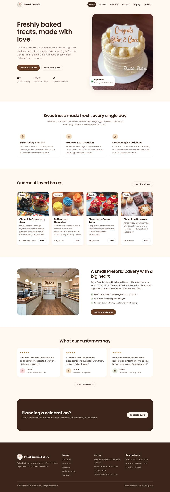
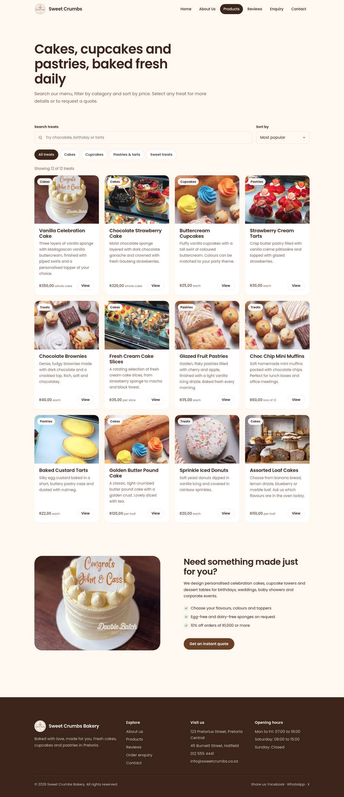
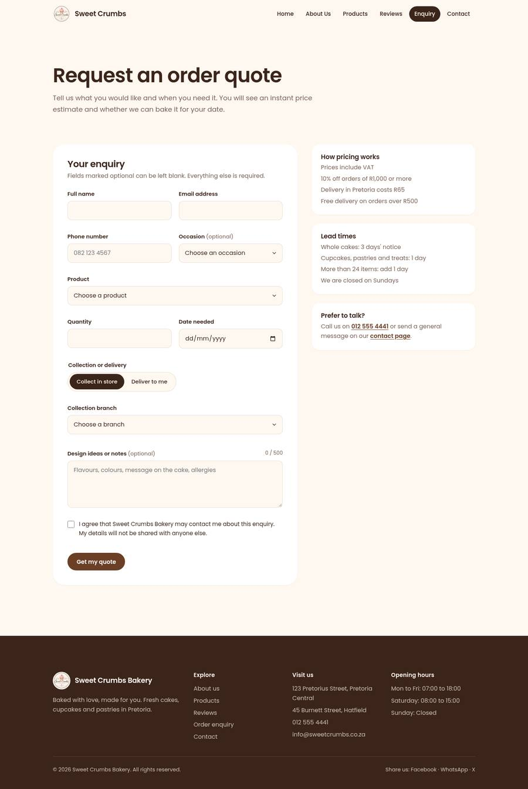
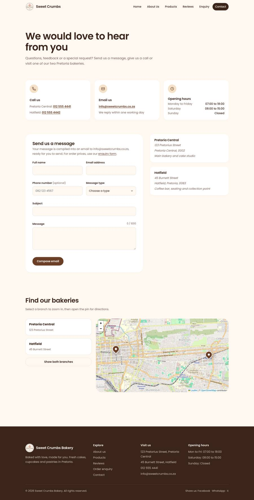

### Tablet

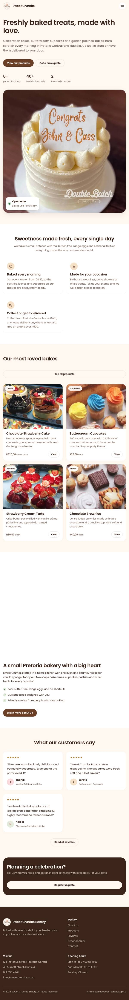
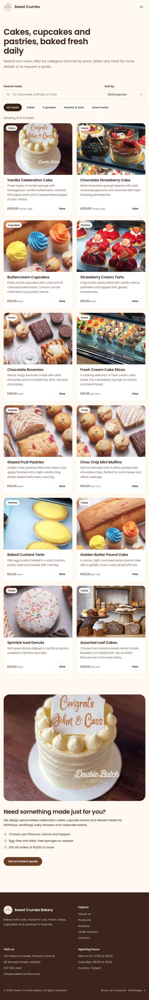

### Mobile

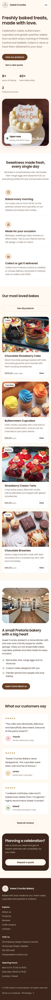
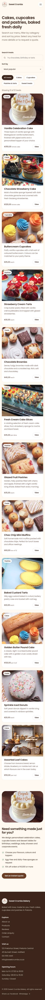
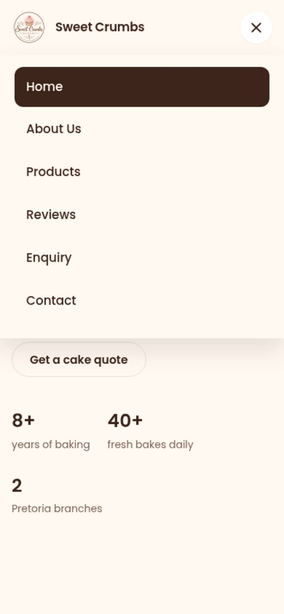

### Features

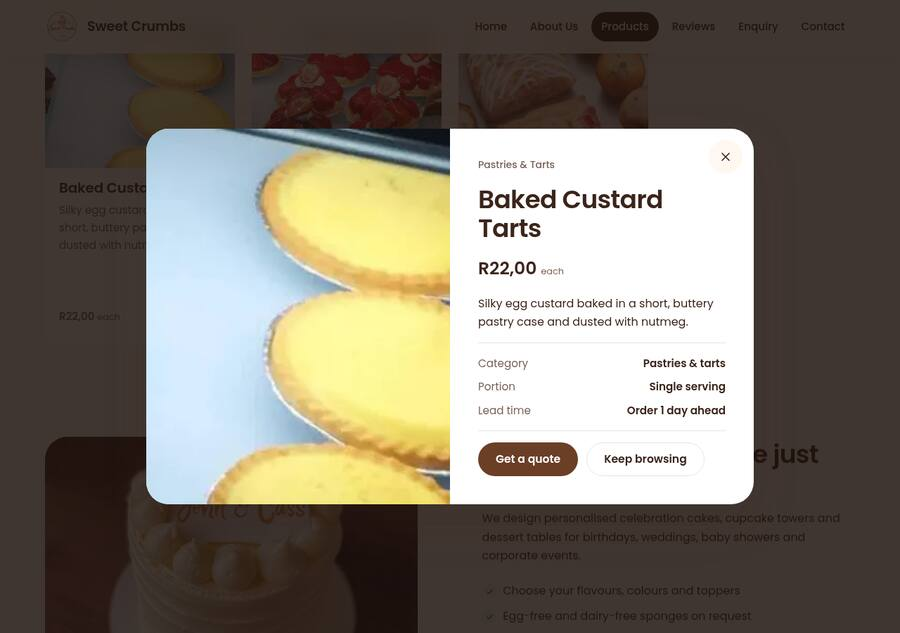
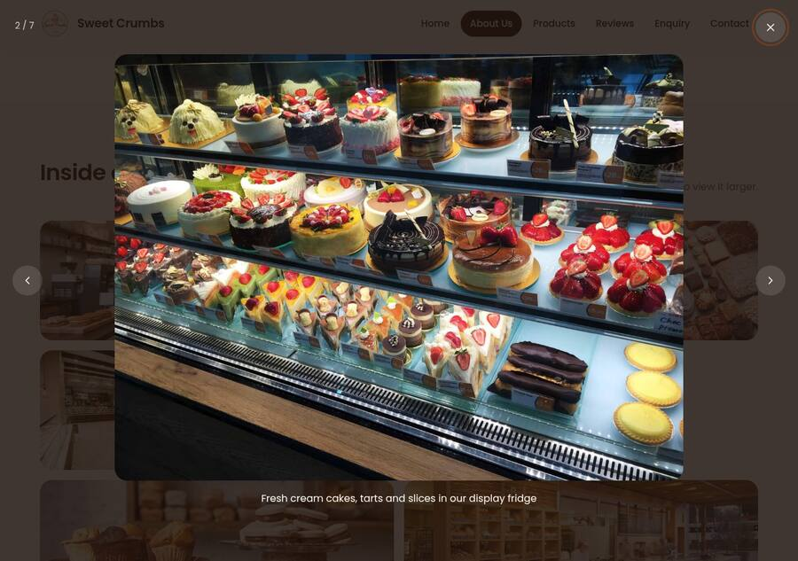
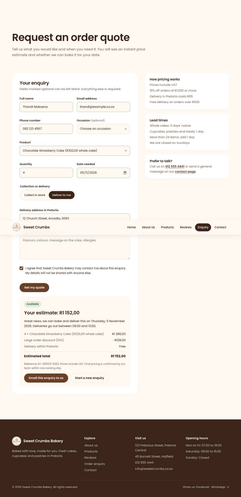

---

## Changelog

### [Part 3: Functionality, Forms and SEO] - October 2026

#### Fixed (based on Part 2 feedback and review)
- **External stylesheet now linked to every page.** The Part 2 stylesheet existed but was never linked in any HTML file, so the site still displayed unstyled. Every page now links `css/style.css`.
- **Removed all deprecated layout HTML.** `<table>` layouts, `<font>`, `<center>`, `bgcolor` and `<br>` spacing were replaced with semantic `<header>`, `<nav>`, `<main>`, `<section>`, `<article>`, `<aside>` and `<footer>` elements.
- **Fixed broken images.** The `images/` folder existed only inside the ZIP, so every image was broken. Images were added to the repository.
- **Fixed broken links.** Links to `products.html`, `about.html` and `enquiry.html` did not match the real file names (`Products.html`, `About Us.html`, `Enquiry.html`). They fail on case-sensitive hosting such as GitHub Pages.
- **Clean file names and URLs.** Renamed `homepage.html` to `index.html`, `About Us.html` to `about.html`, `Products.html` to `products.html`, `Enquiry.html` to `enquiry.html` and `Styles.css` to `css/style.css`. This follows the folder structure required in Part 1, section 4.2.
- **Recreated the missing contact page.** `Contact Us.html` had been deleted. `contact.html` now has contact details, a contact form and a map.
- **Corrected image alt text.** Product images previously showed unrelated photos; for example, "Chocolate Cake" showed a white cake, and "Muffins" and "Brownies" showed shop interiors. Each product now has a matching photo and accurate alt text.
- **Responsive images.** Added `<picture>`, WebP sources, `srcset` and `sizes`, as required by Part 2, section 3.3.
- **More breakpoints.** Added tablet (64rem and 56rem) and mobile (40rem) breakpoints, with layout, typography and navigation changes at each.
- **Accessibility.** Added a skip link, visible focus styles, `aria-current` on the active page, labelled form fields, error messages announced to screen readers, and reduced-motion support.
- **Navigation.** Every page shows the same navigation: Home, About Us, Products, Reviews, Enquiry, Contact.

#### Added
- JavaScript features: mobile menu, scroll animations, product catalogue with search, filter and sort, product modal, gallery lightbox, accordion, tabs, and dynamic reviews.
- Interactive Leaflet map with both branches and directions.
- Enquiry form with validation, quote calculation, availability check and AJAX submission.
- Contact form with validation and email compilation.
- SEO: titles, meta descriptions, keywords, Open Graph tags, canonical links, structured data, `robots.txt` and `sitemap.xml`.
- Security: Content Security Policy, Subresource Integrity and `_headers`.
- `404.html` page, favicon, and optimised, descriptively named images (for example `chocolate-strawberry-cake-480.webp`).
- Screenshots for desktop, tablet and mobile in `docs/screenshots/`.

#### Changed
- Redesigned the visual style with the Poppins font, more white space, rounded cards, soft shadows and pill-shaped buttons, keeping the original brand colours.
- Rewrote `css/style.css` with a CSS reset, design tokens (colours, spacing, type scale), Flexbox and Grid layouts, and `:hover`, `:focus-visible` and `:active` states.
- Expanded page content: brand story, team, FAQ, pricing and lead-time information.

### [Part 2: Visuals, Responsive Design & UX Refactor] - September 2026

#### Added
- External stylesheet with CSS custom properties for the brand colours.
- CSS Grid for the product and review cards, and Flexbox for the navigation.
- A media query at 600px for stacked navigation and single-column cards.

#### Changed
- Planned the replacement of deprecated HTML tags with CSS styling.
- Standardised the navigation links and restyled the buttons.

### [Part 1: Building the Foundation] - August 2026

#### Added
- Initial HTML pages: home, about, products, enquiry, testimonials and contact.
- Navigation between pages, logo and product images.
- Research content ZIP file.

---

## References

Agafonkin, V. 2023. *Leaflet: an open-source JavaScript library for mobile-friendly interactive maps*, version 1.9.4. [Online]. Available at: https://leafletjs.com [Accessed 29 October 2026].

Anthropic. 2026. *Claude* (Opus 5.5) [Large language model]. [Online]. Available at: https://claude.ai [Accessed 29 October 2026].

Formspree. 2026. *Formspree: form backend for static websites*. [Online]. Available at: https://formspree.io [Accessed 29 October 2026].

GitHub. 2026. *Creating a GitHub Pages site*. [Online]. Available at: https://docs.github.com/en/pages/getting-started-with-github-pages/creating-a-github-pages-site [Accessed 29 October 2026].

Google. 2026. *SEO Starter Guide*. Google Search Central. [Online]. Available at: https://developers.google.com/search/docs/fundamentals/seo-starter-guide [Accessed 29 October 2026].

ImageMagick Studio LLC. 2026. *ImageMagick*. [Online]. Available at: https://imagemagick.org [Accessed 29 October 2026].

Indian Type Foundry. 2014. *Poppins*. Google Fonts. [Online]. Available at: https://fonts.google.com/specimen/Poppins [Accessed 29 October 2026].

MDN Web Docs. 2026a. *Client-side form validation*. Mozilla. [Online]. Available at: https://developer.mozilla.org/en-US/docs/Learn/Forms/Form_validation [Accessed 29 October 2026].

MDN Web Docs. 2026b. *Content Security Policy (CSP)*. Mozilla. [Online]. Available at: https://developer.mozilla.org/en-US/docs/Web/HTTP/CSP [Accessed 29 October 2026].

MDN Web Docs. 2026c. *Intersection Observer API*. Mozilla. [Online]. Available at: https://developer.mozilla.org/en-US/docs/Web/API/Intersection_Observer_API [Accessed 29 October 2026].

MDN Web Docs. 2026d. *Responsive images*. Mozilla. [Online]. Available at: https://developer.mozilla.org/en-US/docs/Learn/HTML/Multimedia_and_embedding/Responsive_images [Accessed 29 October 2026].

MDN Web Docs. 2026e. *Using the Fetch API*. Mozilla. [Online]. Available at: https://developer.mozilla.org/en-US/docs/Web/API/Fetch_API/Using_Fetch [Accessed 29 October 2026].

OpenStreetMap contributors. 2026. *OpenStreetMap*. [Online]. Available at: https://www.openstreetmap.org/copyright [Accessed 29 October 2026].

Schema.org. 2026. *Bakery*. [Online]. Available at: https://schema.org/Bakery [Accessed 29 October 2026].

Sitemaps.org. 2016. *Sitemaps XML format*. [Online]. Available at: https://www.sitemaps.org/protocol.html [Accessed 29 October 2026].

W3C Web Accessibility Initiative. 2024a. *Accordion pattern*. ARIA Authoring Practices Guide. [Online]. Available at: https://www.w3.org/WAI/ARIA/apg/patterns/accordion/ [Accessed 29 October 2026].

W3C Web Accessibility Initiative. 2024b. *Tabs pattern*. ARIA Authoring Practices Guide. [Online]. Available at: https://www.w3.org/WAI/ARIA/apg/patterns/tabs/ [Accessed 29 October 2026].

### Image sources

[ADD THE ORIGINAL SOURCE OF EACH PHOTO FROM PART 1 HERE: website name, photographer, URL and date accessed. The celebration cake photo carries a "Double Batch" watermark and must be credited to its owner.]

---

## AI Disclosure

An AI tool, Claude (Anthropic, 2026), was used to help restructure the HTML, write the CSS and JavaScript, optimise the images and draft this README for Part 3. All output was reviewed, tested and edited by the student. See the AI disclosure annexe (with screenshots) submitted with this PoE, as required by IIE guidelines.
